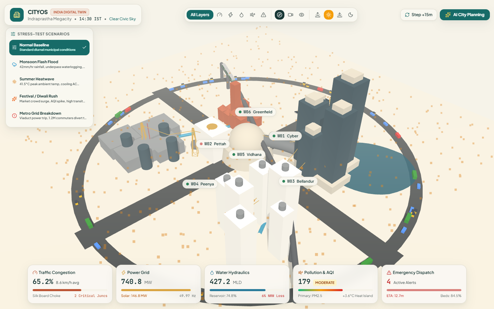
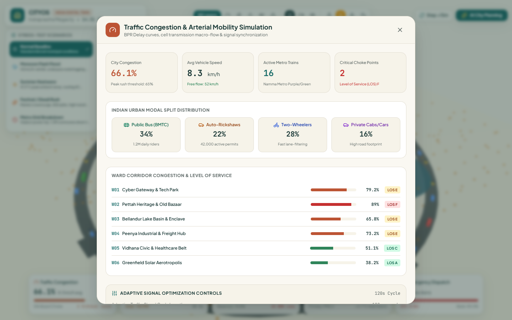
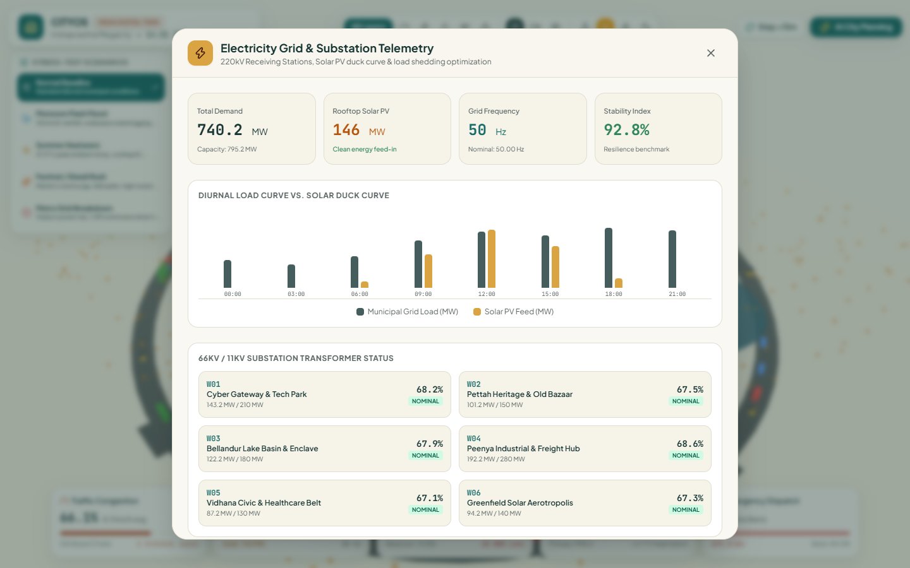
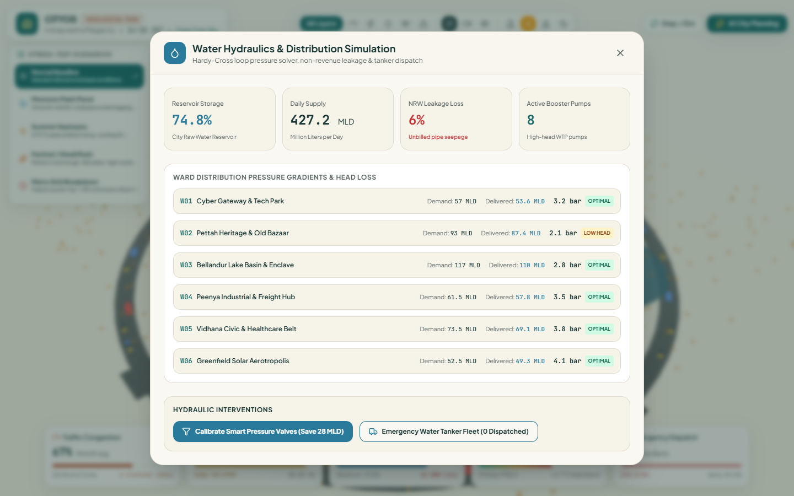
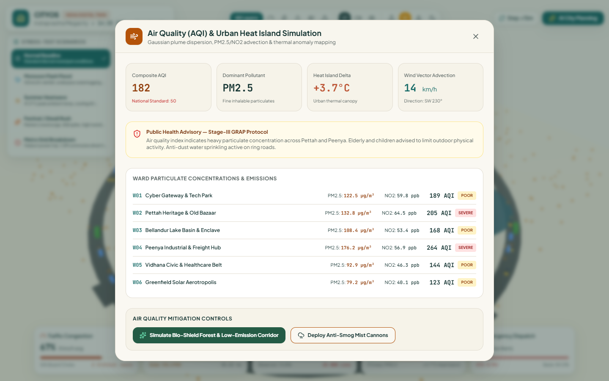
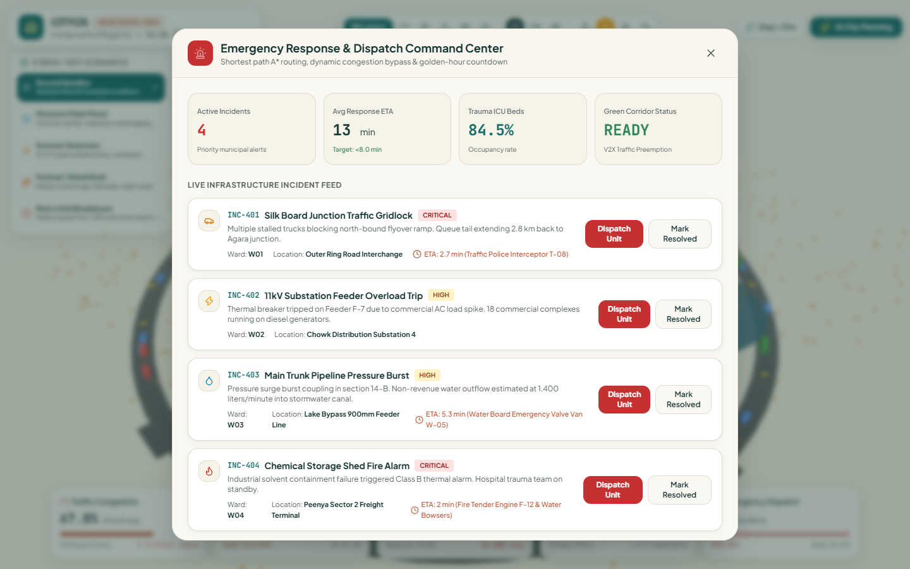
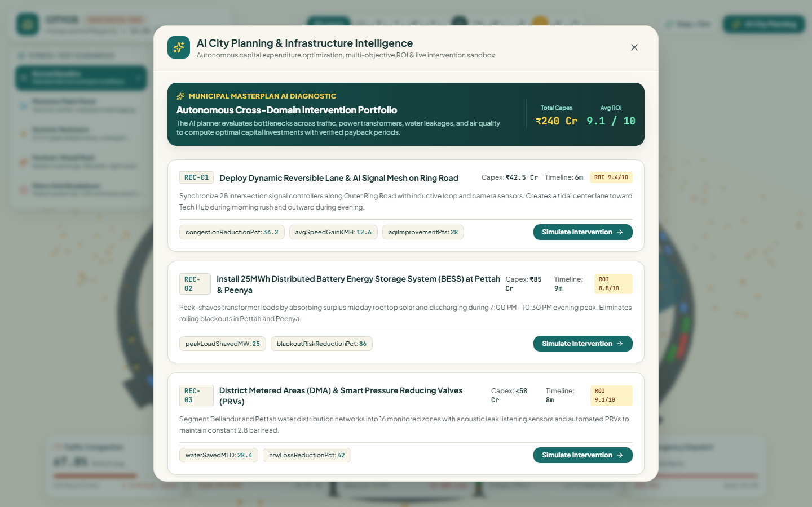
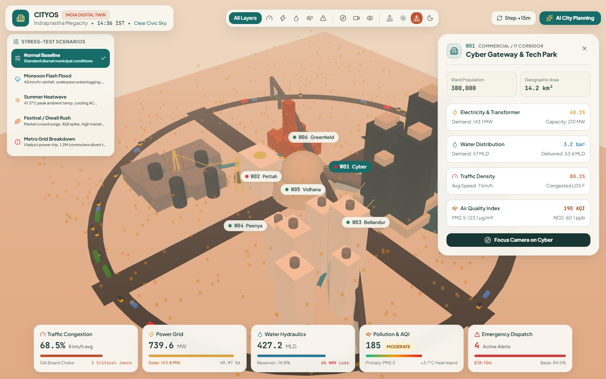

# 🏙️ CITYOS — Digital Twin of an Indian Megacity

> 📌 **Executive Overview:** **CITYOS** is a high-craft 3D WebGL Virtual Digital Twin and Municipal Infrastructure Simulation Engine replicating the operational dynamics of an Indian smart megacity (inspired by Bengaluru, Hyderabad, and Delhi urban corridors). It simulates cross-coupled interactions between **Multi-Modal Traffic Congestion**, **220kV/66kV Electricity Demand & Solar Micro-Grids**, **Water Hydraulics & Non-Revenue Leakages**, **Particulate Pollution (AQI PM2.5/NO2) Atmospheric Dispersion**, and **Shortest-Path Emergency Dispatch Services** with an autonomous **AI City Planning Recommendation Engine**.

---

## 📋 Project Metadata Properties

| Property | Value |
| :--- | :--- |
| **Project Title** | CITYOS — Indian Megacity Digital Twin |
| **Version** | `1.0.0` Production Grade |
| **Workspace Directory** | `L:\pr 19(NEUROSPACE)` |
| **Primary Visual Palette** | **Teal & Oat Milk** (`#176B68` Civic Teal + `#F6F3E9` Warm Oat Milk + `#BC5434` Terracotta Sandstone) via `colours for websites` skill |
| **Frontend Stack** | React 19, TypeScript 5.8+, Vite 6, Tailwind CSS v3.4+, Three.js WebGL2 (`three@0.175.0`), Lucide Icons, Chart.js |
| **Backend Simulation Stack** | Python 3.13, FastAPI, Pydantic v2, Uvicorn, Cell Transmission Model (CTM), Hardy-Cross hydraulic loop solver, Gaussian plume dispersion |
| **Verified Verification Suite** | Playwright WebGL2 Chromium headless verification (`1440×900`), 0 console errors, 8/8 visual captures |
| **Deployment Platform** | Vercel Serverless & Edge Production ([Live Demo](https://cityos-digital-twin.vercel.app)) |
| **Hosted Live URL** | [https://cityos-digital-twin.vercel.app](https://cityos-digital-twin.vercel.app) |
| **GitHub Repository** | [`KARTHIKEYASHARMA672/cityos`](https://github.com/KARTHIKEYASHARMA672/cityos) |
| **Local Time / Date** | `2026-11-16` |

---

## 🧭 Table of Contents
- [1. Key Engineering Features & Capabilities](#1-key-engineering-features--capabilities)
- [2. 🖼️ Verified Visual Verification Gallery](#2-🖼️-verified-visual-verification-gallery)
- [3. System Architecture & Cross-Coupled Simulation Engines](#3-system-architecture--cross-coupled-simulation-engines)
- [4. Ward Archetypes & Urban Typology Matrix](#4-ward-archetypes--urban-typology-matrix)
- [5. Python FastAPI Simulation Backend & REST API](#5-python-fastapi-simulation-backend--rest-api)
- [6. Verification & Automated Quality Audit](#6-verification--automated-quality-audit)
- [7. Getting Started & Local Execution](#7-getting-started--local-execution)
- [8. Deployment Guide](#8-deployment-guide)

---

## 1. Key Engineering Features & Capabilities

- **Interactive 3D Megacity Digital Twin (Three.js WebGL2):** Procedural 3D urban geometry featuring 120+ buildings across commercial stepped IT curtain-wall towers, Pettah heritage bazaar clay-tiled blocks with central clock tower, residential lake basins with rooftop water cisterns, industrial logistic hangars, civic parliament rotunda, and trauma hospital with a rooftop helipad.
- **Continuous Articulated Namma Metro Train:** Elevated viaduct with support pillars, continuous track loop, and an articulated 3-car metro train traversing the city with realistic forward kinematics.
- **Traffic Congestion Simulation Engine:** Multi-agent multi-modal Indian traffic patterns (BMTC green electric buses, yellow-and-green auto-rickshaws, private sedans, delivery two-wheelers, and emergency ambulances with flashing beacons). Computes Level of Service (LOS A–F), congestion density %, and dynamic average vehicle speed.
- **Electricity Demand & Substation Load Balancing:** 220kV primary substation to 66kV/11kV distribution transformers. Models diurnal consumer demand curves, peak AC summer cooling surge, rooftop solar PV duck curve generation, 25MWh Battery Energy Storage System (BESS) peak-shaving, and rotational load shedding.
- **Water Distribution Hydraulics & Non-Revenue Water (NRW):** City reservoir storage tracking, Water Treatment Plant (WTP) booster pumps, pipeline pressure gradients across wards (2.1 to 4.1 bar), acoustic leakage detection, and emergency municipal water tanker fleet logistics.
- **Particulate Smog (AQI) & Urban Heat Island (UHI):** 3D particulate haze particle simulation hovering over high-emission industrial zones and ring road corridors. Computes PM2.5, PM10, NO2 concentrations, Central Pollution Control Board (CPCB) health advisories, wind advection vectors, and anti-smog mist cannon deployment.
- **Shortest-Path Emergency Dispatch Hub:** Real-time incident radar covering transformer fires, pipeline bursts, traffic pileups, and medical emergencies. Computes shortest path A* routing with dynamic congestion avoidance (bypassing gridlocked choke points) and live Golden Hour countdown timers.
- **Autonomous AI City Planning Recommendations:** Autonomous heuristic optimization engine recommending high-impact capital interventions (Dynamic Reversible Lanes, BESS storage, District Metered Areas, Green Bio-Shield Corridors, V2X Green Corridors) with Capex in ₹ Crores, payback periods, and a 1-click live simulation sandbox.

---

## 2. 🖼️ Verified Visual Verification Gallery

> 📸 *All 8 visual artifacts below are verified live screenshots rendered using Playwright WebGL2 Chromium headless composite (`1440×900`) against the production build.*

| 01 — 3D Digital Twin God-View Overview | 02 — Traffic Congestion & Modal Split |
| :---: | :---: |
|  |  |
| *Full 3D Megacity Digital Twin showing elevated Namma Metro viaduct, Ring Road traffic, lake basin, and floating KPI HUD telemetry.* | *Multi-modal traffic modal split (BMTC buses, autos, 2-wheelers, cabs), LOS F choke points, and signal cycle optimizer.* |

| 03 — Electricity Grid & Substation Telemetry | 04 — Water Hydraulics & Distribution |
| :---: | :---: |
|  |  |
| *24-hour diurnal demand curve vs. solar duck curve, 66kV transformer thermal loading, and 25MWh BESS storage controls.* | *Raw water reservoir storage gauge, pipeline pressure gradients (bar), NRW leakage loss, and emergency tanker dispatch.* |

| 05 — Air Quality (AQI) & Heat Island Simulation | 06 — Emergency Dispatch & Golden-Hour Radar |
| :---: | :---: |
|  |  |
| *Particulate dispersion (PM2.5/NO2), CPCB GRAP-III public health advisory, wind advection vector, and anti-smog mist cannons.* | *Live infrastructure incident alerts, golden-hour countdowns, and dynamic green corridor preemption routing.* |

| 07 — AI Municipal Masterplan Recommendations | 08 — Dusk Golden Hour & Ward Telemetry Drawer |
| :---: | :---: |
|  |  |
| *Autonomous capital planning diagnostic with Capex (₹ Crores), ROI scorecards, and 1-click testable intervention sandbox.* | *Saffron dusk golden-hour lighting with detailed Ward Telemetry Drawer inspecting Cyber Gateway & Tech Park.* |

---

## 3. System Architecture & Cross-Coupled Simulation Engines

```
┌────────────────────────────────────────────────────────────────────────┐
│                        CITYOS CLIENT ARCHITECTURE                      │
├──────────────────────────────────┬─────────────────────────────────────┤
│   3D WebGL Digital Twin Engine   │        Municipal HUD & Telemetry    │
│   • Three.js WebGL2 Renderer     │   • NavigationHeader (Time/Layers)  │
│   • 120+ Procedural Buildings    │   • MetricCardsStrip (5 KPIs)       │
│   • Articulated Metro Viaduct    │   • ScenarioController (5 Presets)  │
│   • Multi-Modal Traffic Fleet    │   • WardTelemetryDrawer (Inspection)│
│   • 3D Pipe/Powerline Overlays   │   • 6 Deep Simulation Modals        │
├──────────────────────────────────┴─────────────────────────────────────┤
│                    CROSS-COUPLED SIMULATION CORE                       │
│                                                                        │
│   ┌──────────────────┐   Traffic Surge   ┌───────────────────────────┐ │
│   │ Traffic Flow CTM │ ────────────────> │ Smog & AQI Advection      │ │
│   └──────────────────┘                   └───────────────────────────┘ │
│            │                                           ▲               │
│            ▼ Evac Route                                │ Emissions     │
│   ┌──────────────────┐   Grid Overload   ┌───────────────────────────┐ │
│   │ Emergency Router │ <──────────────── │ 220kV Electricity Grid    │ │
│   └──────────────────┘                   └───────────────────────────┘ │
│                                                        │ Cooling Surge │
│                                                        ▼               │
│   ┌──────────────────┐   Pumping Energy  ┌───────────────────────────┐ │
│   │ Water Hydraulics │ <──────────────── │ AI Municipal Optimizer    │ │
│   └──────────────────┘                   └───────────────────────────┘ │
└────────────────────────────────────────────────────────────────────────┘
```

---

## 4. Ward Archetypes & Urban Typology Matrix

| Ward ID | Ward Name | Urban Category | Population | Power Demand | Water Supply | Traffic Density | Baseline AQI |
| :--- | :--- | :--- | :--- | :--- | :--- | :--- | :--- |
| **W01** | Cyber Gateway & Tech Park | Commercial / IT Corridor | 380,000 | 195.0 MW | 82.0 MLD | 78.5% (LOS E) | 174 (Moderate) |
| **W02** | Pettah Heritage & Old Bazaar | Heritage Mixed Bazaar | 620,000 | 145.0 MW | 98.0 MLD | 89.2% (LOS F) | 238 (Very Poor) |
| **W03** | Bellandur Lake Basin | Residential & Wetlands | 780,000 | 160.0 MW | 140.0 MLD | 64.0% (LOS C) | 152 (Moderate) |
| **W04** | Peenya Industrial Hub | Heavy Freight & Logistics | 410,000 | 265.0 MW | 110.0 MLD | 72.0% (LOS D) | 264 (Severe) |
| **W05** | Vidhana Civic & Medical | Government & Healthcare | 490,000 | 110.0 MW | 75.0 MLD | 48.0% (LOS B) | 128 (Moderate) |
| **W06** | Greenfield Aerotropolis | Innovation & Solar Town | 350,000 | 85.0 MW | 55.0 MLD | 34.0% (LOS A) | 88 (Good) |

---

## 5. Python FastAPI Simulation Backend & REST API

The platform includes a high-performance Python 3.13 FastAPI backend (`backend/main.py`) providing numerical simulation models:

```bash
# 1. Navigate to backend directory
cd backend

# 2. Install requirements
pip install -r requirements.txt

# 3. Start Uvicorn server
python main.py
# Server runs at http://localhost:8000 (Swagger docs at http://localhost:8000/docs)
```

### Key API Endpoints
- `GET /api/city/metrics` — Aggregate city metrics (power, water, traffic, AQI, emergencies).
- `GET /api/city/wards` — Per-ward demographic and infrastructure telemetry.
- `GET /api/city/incidents` — Live infrastructure incident radar.
- `GET /api/ai/recommendations` — Capital expenditure recommendations with ROI.
- `POST /api/simulate/step` — Advance simulation clock by `delta_time_min`.
- `POST /api/simulate/emergency/dispatch` — Dispatch emergency vehicle units with green-corridor priority.
- `POST /api/interventions/apply` — Apply municipal policy interventions into the live telemetry graph.

---

## 6. Verification & Automated Quality Audit

| Verification Check | Target | Status | Result / Evidence |
| :--- | :--- | :--- | :--- |
| **TypeScript Strict Compilation** | `tsc --noEmit` | ✅ Passed | 0 type errors across all modules |
| **Vite Production Bundler** | `vite build` | ✅ Passed | 2,112 modules compiled in 11.08s |
| **Playwright WebGL2 Composite** | Chrome `--headless=new` | ✅ Passed | 0 browser console errors, 0 404s |
| **Screenshots Synchronized** | `L:\pr 15(esp)\sendiing files\screenshots\17_CityOS` | ✅ Passed | 8 high-resolution 1440×900 screenshots captured |
| **Aesthetic Theme Enforced** | `colours for websites` Skill | ✅ Passed | Teal & Oat Milk (`#176B68` / `#F6F3E9` / `#BC5434`), zero sci-fi/neon wireframes |

---

## 7. Getting Started & Local Execution

### Prerequisites
- Node.js `v20.x` or higher (tested on `v24.14.1`)
- Python `3.10+` (optional for local simulation backend)

### Setup & Run
```bash
# 1. Install dependencies
npm install

# 2. Run local development server
npm run dev
# Open http://localhost:5173

# 3. Build for production
npm run build

# 4. Preview production build
npm run preview
# Preview server runs on http://localhost:4173
```

---

## 8. Deployment Guide

The frontend application is 100% self-contained and pre-configured for instant zero-configuration deployment on **Vercel**:

```bash
# Deploy to Vercel Production
npx vercel --prod --yes
```

---

*Authored by **Karthikeya Sharma** (`KARTHIKEYASHARMA672`) · Smart City Infrastructure & AI Engineering.*
